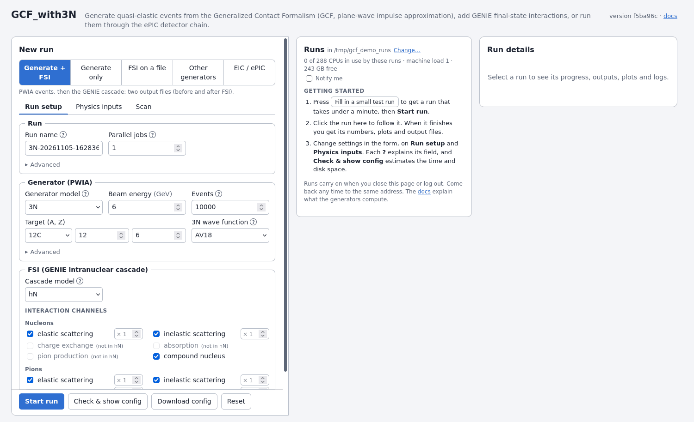
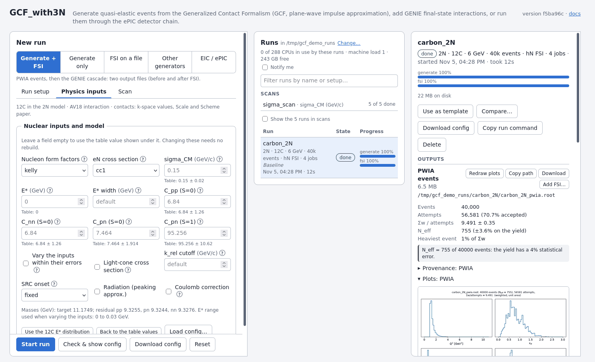
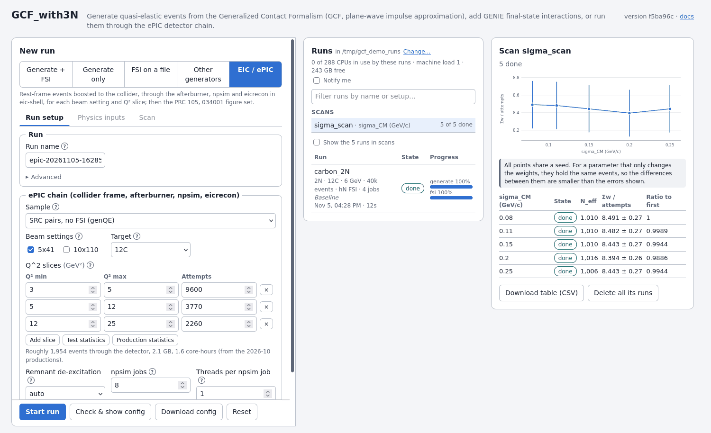
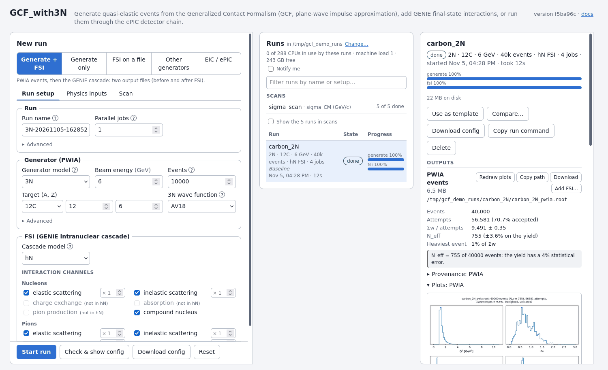
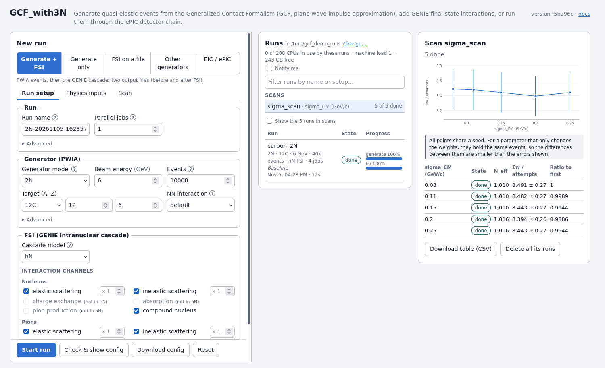

# Using the web interface

`./gcf gui` is a web page for setting up event generation, running it and reading
the results. This guide is for someone who has never used it. What the generators
compute is in [PHYSICS.md](PHYSICS.md), and the command line and file formats are in
[PIPELINE.md](PIPELINE.md).

## Contents
- [Start it](#start-it)
- [Your first run](#your-first-run)
- [Setting up a run](#setting-up-a-run)
- [Reading the results](#reading-the-results)
- [Scans](#scans)
- [Leaving and coming back](#leaving-and-coming-back)
- [Sharing a machine](#sharing-a-machine)
- [When something goes wrong](#when-something-goes-wrong)
- [The same from a terminal](#the-same-from-a-terminal)
- [Terms](#terms)

## Start it

Do this once, on the machine that will run the jobs:

```bash
./install.sh         # builds the programs and sets up the Python packages
./gcf doctor         # checks that everything is ready, and says how to fix what isn't
```

Then, **on your laptop**, one command starts the page (if it isn't running), opens an
SSH tunnel to it and opens your browser:

```bash
ssh you@machine cat src/GCF_with3N/tools/gcf/gcf-open | sh -s you@machine
```

Put your checkout's path after the second `you@machine` if it isn't `~/src/GCF_with3N`,
and `gcf gui` options after that. Run it again whenever you like: it reuses the page and
a tunnel that still works. It needs a POSIX shell (macOS, Linux, WSL or Git Bash), and
with SSH keys it doesn't ask for your password.

Or, on the machine:

```bash
./gcf gui --background
```

In a VS Code remote terminal, or on a desktop you're sitting at, this opens the page in
your browser by itself (`--no-browser` stops that). Otherwise it prints an SSH command
and an address:

1. On your laptop, run the `ssh -N -L ...` command it printed and leave it running.
   VS Code Remote-SSH forwards the port for you, and you don't need a tunnel if the
   browser runs on the same machine.
2. Open the address in your browser, including the `?token=...` part. The token is
   the password, so don't share the address. It stays the same when the page
   restarts, so you can bookmark it.

`./gcf gui --status` shows the address again, and `./gcf gui --stop` stops the page.
Stopping the page doesn't stop your runs.

Runs go to `<repository>/runs`, or `~/gcf_runs` if you can't write to the checkout.
Event files can be large, so choose a place with room: `./gcf gui --background
--runs-dir /path/with/space`, or **Change…** next to **Runs** on the page.

## Your first run

On an empty page, **Getting started** has a **Fill in a small test run** button.
Press it, then **Start run**. It takes under a minute. Click the run to see its
numbers, plots and output files.



## Setting up a run

Choose what to run at the top of the form:

| Choice | What it does |
|---|---|
| **Generate + FSI** | Quasi-elastic events, then the GENIE cascade. Two output files, before and after FSI. |
| **Generate only** | Events without final-state interactions. |
| **FSI on a file** | The cascade on an existing event file, also from another generator. |
| **EIC / ePIC** | Events through the collider-frame boost, the afterburner, `npsim` and `eicrecon`, then the figures. |
| **Other generators** | `genDIS`, `genCCQE`, `genPhoto`, `genElectro`, `genIon`, `sfSampler`. |

Fill in the form. The **?** next to a field explains it, and the fields change with
the generator model. The form checks your values as you type, and says which field
to change.

**Check & show config** runs a short test of the real programs and tells you what to
expect: the time, the disk space and the effective number of events. Do this before
a large run. **Examples…** and **Load config…** fill the form from an example or from
a config you saved.

### Physics inputs



This tab holds the settings of the physics model. Each nuclear input shows the value
from the generator's tables for your target and interaction, with its uncertainty. An
empty field uses that value, and none of this needs a rebuild.

- **Contacts** (2N): these only change the event weights. For a contact study you can
  also reweight existing events (`band` in `tools/eic_src_analysis.py`). 3N has no
  contacts yet: its absolute scale is a placeholder (#73).
- **E\*** and its width: the excitation energy of the residual. On 12C, **Use the 12C
  E\* distribution** fills in the measured one.
- **Vary the inputs within their errors** (2N): one random draw per run, for
  systematics. All jobs of a run use the same draw.
- Also here: the cross section and form factors, the light-cone cross section,
  radiation, the Coulomb correction, and the cutoffs.

### Interaction channels

For FSI, untick a channel to switch it off, or type a factor next to it to scale its
rate. The other fates are renormalized.

### EIC / ePIC



This runs the chain in `tools/run_eic_sim.sh` inside `eic-shell`, for each beam setting
and Q² slice, then draws the figures of PRC 105, 034001. Choose the sample, the beams, the
target and the Q² slices. **Test statistics** fills in 1% of the production's, which takes
minutes and a few GB, so start there. **Check** looks for the geometry, EICrecon and field
maps and estimates the cost. The far-forward results depend on which geometry and EICrecon
you use: see the warning about them in [PIPELINE.md](PIPELINE.md). Scans and **Use the
finished jobs** aren't available for this stage, but **Resume** is: finished slices and
chunks stay.

### Other generators

These write their own tree, `genT`, so plots, FSI and comparing aren't available for
their files. The form lists each one's known physics issues: read them before using
its output. Only `genDIS` takes a seed so far, so the others can't be repeated exactly.

## Reading the results



Click a run to open it.

**Numbers.** Each output lists:

- **Σw / attempts**: the weighted yield per generation attempt, with its statistical
  error. This is the quantity to compare between samples of the same model.
- **N_eff**: how many equal-weight events the sample is worth. Weights can vary by
  orders of magnitude, so it can be far below the event count, and it sets the
  statistical error: about 1/√N_eff. In one test, 4,000 3N events gave N_eff = 20.
- **Warnings**: read them. A red one means the shapes can't be trusted yet.
- **Provenance**: the code version, seeds, command and nuclear inputs that made the file.

**Plots** are drawn when you open a finished run. Under **Selection**, set limits on
Q², x_B, θ_e, p_miss or the proton count to redraw them and see what share of the
yield passes.

**Compare…** compares the outputs of two runs: Σw / attempts with the pull between
them, and whether the shapes of each distribution differ. The test uses the event
weights, so it also sees changes that only move weights. "No difference" means none
larger than the statistics can show, so check the N_eff it quotes. It flags a shape
only at p ≤ 0.001, and runs with the same seed may share events, which makes it
conservative.

**Files.** Outputs are `<name>_pwia.root` and `<name>_fsi.root` in the run's directory,
with `config.toml` and `logs/`. Use **Download**, or **Copy path** to read them on the
machine. **Add FSI…** runs the cascade on a run's PWIA events, so you can try hN and
hA on the same events.

## Scans



The **Scan** tab runs the setup from the other tabs for several values of a parameter,
or a grid of several parameters. Give the values as `0.10, 0.15, 0.20` or as
`0.1:0.2:5` (start, stop, count).

Each point is an ordinary run that waits its turn, and a mistake in one point starts
none of them. The scan shows a table and a plot of Σw / attempts, and a CSV to
download. All points share a seed. For a parameter that only changes the weights, they
then hold the same events, so the differences between them are smaller than the errors
shown. Scanning **Base seed** with **Vary the inputs** on makes replicas for a
systematic band.

## Leaving and coming back

You don't need `tmux` or `screen`. Runs are started on their own, without a terminal,
so you can close the page, close your laptop or log out, and they carry on. Come back
to the same address, or use `./gcf status` in a terminal.

| What happens | What it means for your runs |
|---|---|
| You close the browser or lose the connection | Nothing. The page reconnects by itself. |
| The page stops, or you log out without `--background` | Runs carry on. Start the page again to see them. |
| A run's supervising process dies, for example of low memory | Its jobs carry on, and the page gives them a new supervisor within seconds. |
| The machine restarts | Runs that were in progress continue when the page starts again, at most 3 times per run. |
| A job fails | The other jobs finish. **Resume** reruns only what didn't finish. |
| You cancel a run | **Resume** finishes it later, or **Use the finished jobs** makes files from what's there. |

Long runs lose little, because a run is split into jobs of at most a million events.
Only unfinished jobs run again, with the same seeds, so you get the same events as if
it had never stopped. If you edit a run's config in between, a job made with other settings
isn't kept: it runs again.

To start the page by itself after a restart, add this to your `crontab`:

```
@reboot cd /path/to/GCF_with3N && ./gcf gui --background
```

On a few systems, logging out kills all your processes, whatever started them. `./gcf
doctor` warns about this. The fix is `loginctl enable-linger $USER`, which may need your
administrator.

## Sharing a machine

- Each person starts their own page, with their own runs directory and token. A taken
  port moves to the next free one by itself.
- **CPU limit.** The runs of one page share a limit, all CPUs by default. On a shared
  machine, set yours with `./gcf gui --background --max-cpus 32`. A run that doesn't
  fit waits in a queue and starts by itself, and the queue survives restarts.
- The line under **Runs** shows the CPUs your runs use, the machine's load and the free
  disk space. The limit only counts your page's runs, so look at the load before a large
  run. It turns amber when the machine is busier than it has CPUs.
- **Don't share your address.** Anyone with it can start runs and read files as you. To
  replace it: `./gcf gui --new-token`, which takes effect at once, also on a page that is
  already running. Don't use `--host` on a network you don't trust,
  because the page has no encryption of its own. The SSH tunnel provides that.

## When something goes wrong

| What you see | What to do |
|---|---|
| A banner at the top of the page | It names what's missing and how to fix it. `./gcf doctor` shows the same. |
| "stage programs match the code" warning | The code changed since the last build. Run `./install.sh`. |
| "Cannot reach gcf gui" | The page stopped or the tunnel is down. Your runs carry on. `./gcf gui --background`, and restart the tunnel. |
| "This address no longer works" | The token changed. `./gcf gui --status` shows the new address. |
| A run is `queued` for a long time | Other runs of yours are using its CPUs. See the line under **Runs**. |
| A run is `stopped` | **Resume** continues it. Nothing it finished is lost. |
| A run is `failed` | The details show the error, and usually what to do. Open **Logs**, then **Resume** once it's fixed. |
| A run `failed` with "not started: others can write" | Someone else could have changed what would run as you. If you trust them, `chmod -R go-w` on its directory, as the message says. |
| No plots or summary | The Python packages are missing: `tools/gcf/setup_python.sh`. |
| A file that "has already been through FSI" | Use the `*_pwia.root` file, or tick **Replace earlier FSI in the input** under **Advanced**. |
| No events, or a red N_eff warning | Check the beam energy against the reaction's threshold and your limits, or generate more events. |

## The same from a terminal

Everything the page does goes through `gcf run`, and each run keeps its config, so
**Copy run command** repeats a run from the repository root. The same config, seed and
number of jobs give the same events.

```bash
./gcf run --detach my_run.toml                  # start a run on its own
./gcf status                                    # what is running, and how far
./gcf run --resume --detach runs/x/config.toml  # continue one
./gcf scan my_run.toml --set generate.sigma_cm=0.1,0.15,0.2
./gcf summary runs/x/x_fsi.root                 # the numbers of a file
./gcf quicklook runs/x/x_fsi.root --q2 2:5      # its plots, with a selection
```

## Terms

| Term | Meaning |
|---|---|
| GCF | Generalized Contact Formalism: the description of short-range correlated pairs behind the generators. |
| SRC | Short-range correlation: nucleons close together, with high relative momentum. |
| PWIA | Plane-wave impulse approximation: the electron hits one nucleon, and nothing rescatters. |
| FSI | Final-state interactions: outgoing nucleons rescatter in the nucleus, simulated with the GENIE cascade. |
| 3N, 2N, MF | The struck nucleon comes from a correlated triplet, a correlated pair, or the mean field. |
| hN, hA | GENIE's cascade models: full hadron-nucleon, or an effective hadron-nucleus model that is faster. |
| Contact | How many correlated pairs of a kind a nucleus has, in the GCF. |
| sigma_CM | The width of the centre-of-mass motion of a correlated pair or triplet. |
| E\* | The excitation energy of the nucleus left behind. |
| Σw / attempts | The weighted yield per generation attempt: the quantity to compare between samples. |
| N_eff | Effective number of events, (Σw)²/Σw². |
| Job | One piece of a run. Parallel jobs is how many run at a time. |
